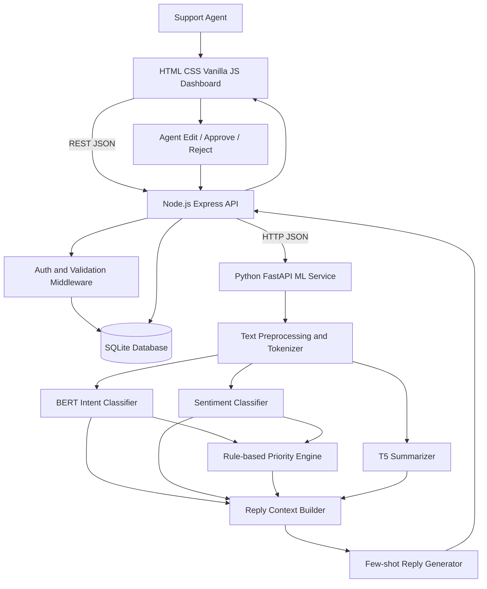
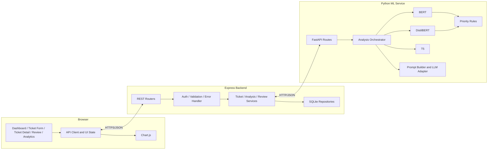
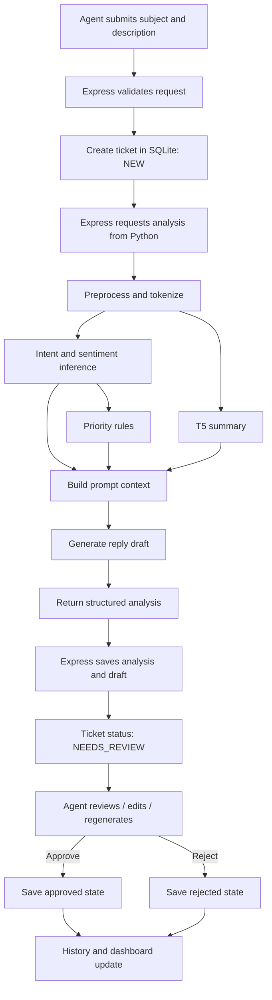
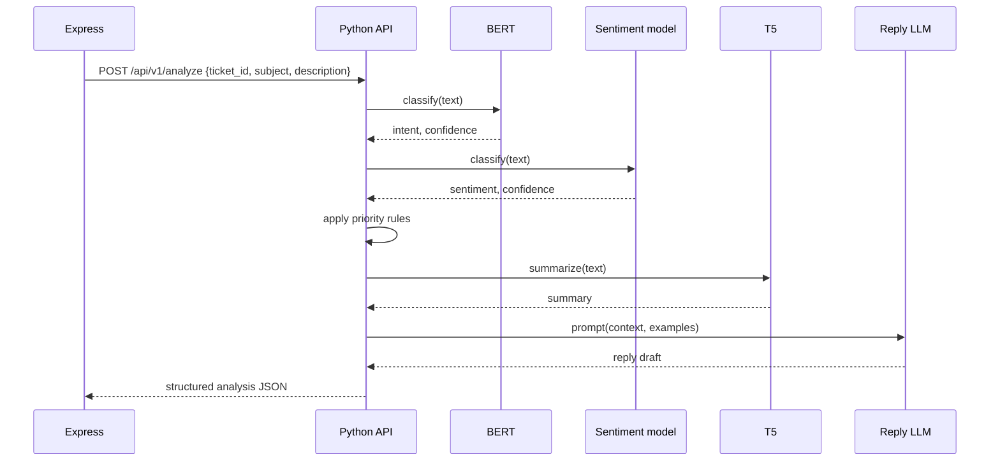
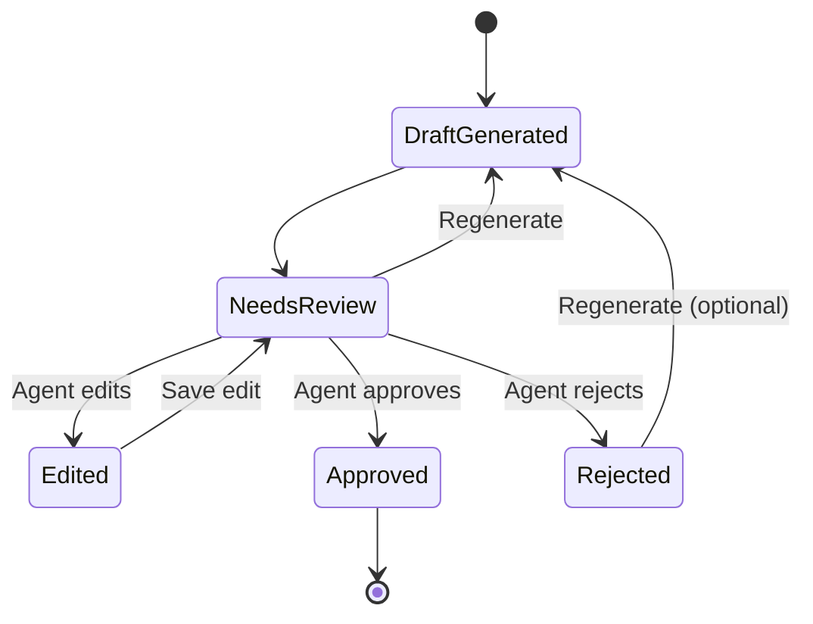
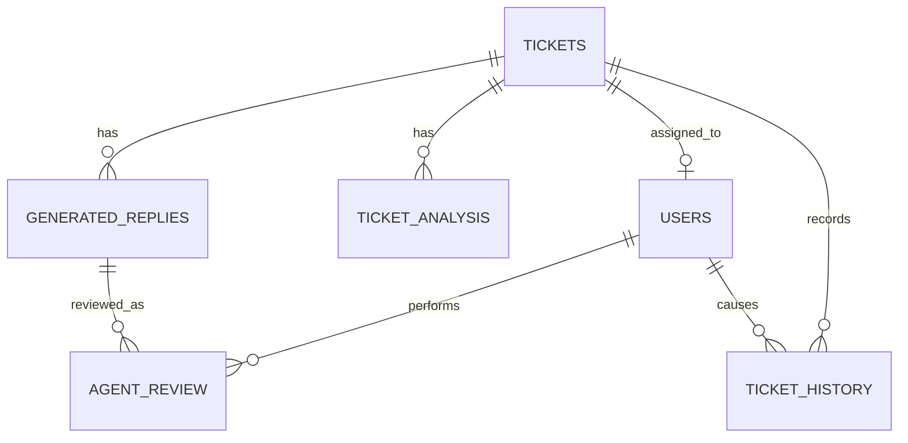

# SupportIQ — Intelligent Support Ticket Triage and Auto-Reply Engine

> **Technical blueprint, research record, implementation guide and hand-off specification**  
> Academic context: MCA (Data Science) project  
> Document status: **Implementation specification — research-backed baseline**  
> Last reviewed: 3 November 2026

---

## Document control and instructions to the development agent

This document is the source of truth for the first implementation. Build only what is specified here. Do not silently change the mandatory stack, invent model results, treat inferred labels as ground truth, or send customer replies automatically.

### Mandatory architecture (overrides earlier alternatives in the source brief)

| Layer | Required technology | Responsibility |
|---|---|---|
| Frontend | HTML5, CSS3, Vanilla JavaScript, optional Bootstrap 5, Chart.js | Responsive agent dashboard and browser interactions |
| Backend | Node.js, Express.js, REST, SQLite | Authentication, validation, business workflow, persistence and API gateway |
| ML service | Python, PyTorch, Hugging Face Transformers, Scikit-learn, Pandas, NumPy | All NLP inference, training and generation |
| Service communication | HTTP + JSON on localhost | Express calls Python ML service |
| Persistence | SQLite accessed by Express | Tickets, analysis, replies, reviews, audit history |

**Prohibited:** React, Angular, Vue, Streamlit, RNN/LSTM, vector databases, RAG, deepfake features, machine-learning implementation in JavaScript, duplicated ML logic in Express, automatic reply sending.

### Non-negotiable development rules

1. Research and architecture decisions precede implementation.
2. Maintain `DEVELOPMENT_LOG.md`, `DECISION_LOG.md`, `TASK_CHECKLIST.md` and module status.
3. Test modules independently before integration.
4. Keep real labels, model predictions, heuristic/rule-derived values and human annotations distinct in code, UI and database.
5. Do not claim benchmark performance until the experiment has actually been run and its split/configuration recorded.
6. Use `.env` for secrets and `.env.example` for names/placeholders only.
7. The system generates **drafts only**. An authenticated human agent must approve a reply before any future sending integration; sending is out of scope for this version.
8. If a source, license detail, model compatibility or external service behavior cannot be confirmed, record **To Be Verified** and do not guess.

---

## Table of contents

1. [Abstract](#1-abstract)
2. [Problem statement, rationale and scope](#2-problem-statement-rationale-and-scope)
3. [Objectives and success criteria](#3-objectives-and-success-criteria)
4. [Research and literature review](#4-research-and-literature-review)
5. [Syllabus mapping](#5-syllabus-mapping)
6. [Dataset research and selection](#6-dataset-research-and-selection)
7. [Technology stack and runtime design](#7-technology-stack-and-runtime-design)
8. [System architecture and workflows](#8-system-architecture-and-workflows)
9. [Functional modules](#9-functional-modules)
10. [Model selection and implementation](#10-model-selection-and-implementation)
11. [Project directory structure](#11-project-directory-structure)
12. [Database design](#12-database-design)
13. [REST API and service contracts](#13-rest-api-and-service-contracts)
14. [Model training and evaluation](#14-model-training-and-evaluation)
15. [Security, privacy and ethics](#15-security-privacy-and-ethics)
16. [Four-week development roadmap](#16-four-week-development-roadmap)
17. [Step-by-step implementation guide](#17-step-by-step-implementation-guide)
18. [Testing strategy](#18-testing-strategy)
19. [User interface specification](#19-user-interface-specification)
20. [Expected outcomes and final deliverables](#20-expected-outcomes-and-final-deliverables)
21. [Demonstration and screenshot plan](#21-demonstration-and-screenshot-plan)
22. [Risks, limitations and future scope](#22-risks-limitations-and-future-scope)
23. [First five actions for the coding agent](#23-first-five-actions-for-the-coding-agent)
24. [References](#24-references)

---

## 1. Abstract

SupportIQ is a human-supervised customer-support ticket triage application. An agent enters or reviews a customer ticket. A separate Python machine-learning service preprocesses the text and produces an intent prediction using a fine-tuned BERT classifier, a sentiment prediction using a pretrained sentiment model, a transparent rule-based priority recommendation, a concise T5 summary and a suggested support reply generated from a controlled prompt template. Express coordinates requests, persists the ticket and analysis in SQLite, and serves a browser-based dashboard built with HTML, CSS, Vanilla JavaScript, Bootstrap 5 (optional) and Chart.js.

SupportIQ is not a general-purpose chatbot. It is an agent-assistance workflow: it structures incoming work, surfaces useful signals, prepares a draft and leaves the final decision with a human. The project demonstrates the four syllabus experiments—text preprocessing/tokenization, BERT classification, T5 summarization and prompt engineering—within one practical application.

The first release is a local academic prototype. It uses public datasets for experimentation and clearly marks dataset limitations. BANKING77 provides intent labels only; it does not provide ticket sentiment, priority, reference summaries or replies. Bitext provides customer-support instructions, intent/category metadata and example responses, but it is a hybrid generated/curated dataset and is not evidence of real operational customer outcomes. The implementation must not pretend otherwise.

## 2. Problem statement, rationale and scope

### 2.1 Problem statement

Support teams receive many messages and must read, categorize, prioritize, summarize and answer them. Repeating these tasks manually can delay handling and create inconsistent triage. SupportIQ assists the first stage by extracting structured information and drafting a response for an agent to review.

### 2.2 Why the project is required

- Support requests often arrive as unstructured text.
- Agents need a quick view of the customer's likely issue and emotional tone.
- Urgent issues should be visible without relying only on manual scanning.
- A concise summary can reduce repeated reading when tickets are long.
- Draft replies can reduce repetitive writing while retaining human accountability.
- A dashboard makes workload, ticket state and model behavior inspectable.

### 2.3 What makes it different from a simple chatbot

| Simple chatbot | SupportIQ |
|---|---|
| Primarily responds to a user in a conversation | Processes and manages support tickets |
| Often focuses on direct answer generation | Combines classification, sentiment, priority, summary and reply draft |
| May hide internal decision signals | Displays predictions, confidence and priority reasons |
| Commonly responds directly | Requires human review and records approval/edit/rejection |
| Conversation-centric | Ticket lifecycle, history and analytics-centric |

### 2.4 Scope of the first release

**In scope:** manual ticket creation; generated ticket ID; ticket list and details; text preprocessing; BERT intent classifier; pretrained sentiment classifier; rule-based four-level priority; T5 summary; few-shot reply draft; edit/approve/reject/regenerate; status history; SQLite persistence; dashboard and charts; evaluation scripts and tests.

**Out of scope:** integration with live email/CRM/helpdesk systems; automatic outbound email or message sending; RAG; vector search; autonomous agent actions; multilingual production support; SLA prediction; model training on private customer data; production-grade multi-tenant deployment.

### 2.5 Assumptions

- Initial demonstration language is English.
- A local development environment can run Node.js and Python separately.
- Model weights may be downloaded from Hugging Face on first run; later local inference can use cached weights.
- A GPU is optional. CPU inference is supported but may be slower.
- Reply generation uses a configured compatible instruction-following LLM/API. If no provider credentials are available, the application must show a clear unavailable state and use a clearly labelled deterministic demo fallback only for UI testing—not represent it as an LLM result.

## 3. Objectives and success criteria

### 3.1 Measurable objectives

| Objective | Measurement / acceptance criterion |
|---|---|
| Store and manage tickets | Create, list, view, update status and retrieve ticket history successfully |
| Predict ticket intent | Train and evaluate BERT; report accuracy, precision, recall, macro-F1, weighted-F1 and confusion matrix on held-out data |
| Detect sentiment | Return positive/negative/neutral only if a validated three-class model or project-specific annotation supports all three; otherwise disclose the binary model limitation |
| Recommend priority | Every priority output includes rule reasons and source signals; no unexplained model-only priority |
| Summarize ticket | Return a short summary; evaluate against human-written references where available and include human review |
| Draft replies | Compare zero-shot, few-shot and structured prompting using a fixed evaluation rubric |
| Human oversight | Reply cannot become approved without an authenticated agent action; edit/reject/regenerate actions are audited |
| Dashboard | Show ticket counts, priority/status/intent/sentiment distributions and processing-time summaries based on stored records |
| Reproducibility | Save dataset version/source, model identifiers, configuration, random seed and evaluation output |

### 3.2 Definition of done

The MVP is complete when an agent can create a ticket, run analysis, inspect all outputs and their provenance, edit or reject a draft, approve a draft, view the resulting audit history, and see ticket aggregates on the dashboard. All endpoints have validation and tests. No reply is automatically transmitted outside the application.

## 4. Research and literature review

This section distinguishes established source information from project design choices.

### 4.1 Customer-support automation and ticket classification

Customer-support automation commonly uses intent detection to map free-text requests into predefined service categories. BANKING77 is a research dataset designed for fine-grained single-domain intent detection and contains 13,083 queries across 77 intents. The dataset paper is *Efficient Intent Detection with Dual Sentence Encoders* (Casanueva et al., 2020). It is useful for demonstrating multiclass intent classification, but its banking domain does not represent every support organization.

**Project decision:** BANKING77 is the primary reproducible benchmark for the BERT intent experiment. A production-like demonstration can additionally use a small manually reviewed SupportIQ ticket taxonomy, but those labels must be explicitly identified as project annotations.

### 4.2 BERT for intent classification

BERT uses bidirectional Transformer encoder representations and was pretrained with masked language modeling and next-sentence prediction objectives. A sequence-classification head can be fine-tuned using labeled text and intent IDs. The official `google-bert/bert-base-uncased` model card identifies it as an English pretrained checkpoint and lists approximately 110M parameters.

**Project decision:** fine-tune `google-bert/bert-base-uncased` for the main intent experiment. Use `distilbert/distilbert-base-uncased` as a lighter comparison only if time and compute allow. The model confidence is a softmax score, not a guarantee of correctness; confidence calibration and out-of-domain behavior must be discussed.

### 4.3 T5 for summarization

T5 frames NLP tasks as text-to-text generation and uses task prefixes such as `summarize:`. Hugging Face's T5 documentation describes an encoder-decoder Transformer family with model sizes ranging from small to very large.

**Project decision:** start with `google-t5/t5-small` for local resource-conscious inference. Evaluate FLAN-T5-small as an optional instruction-tuned comparison if its exact model card and environment compatibility are verified. The model must not add details absent from the ticket; summaries remain drafts for agent inspection.

### 4.4 Sentiment analysis

A pretrained DistilBERT checkpoint fine-tuned on SST-2 is a binary positive/negative sentiment classifier. Its model card reports the checkpoint's SST-2 evaluation context and documents limitations/bias risks. It does **not** natively establish a neutral class.

**Project decision:** use `distilbert/distilbert-base-uncased-finetuned-sst-2-english` as a binary baseline, label it honestly as `positive` or `negative`, and do not relabel low-confidence predictions as neutral. If the UI requirement insists on positive/neutral/negative, select and validate a genuine three-class checkpoint or annotate a project dataset and train/evaluate a three-class classifier before enabling that label set. Until then show `uncertain` as a UI confidence state, not as a model class.

### 4.5 Few-shot prompting for reply drafting

Few-shot prompting supplies a small number of input-output examples in the prompt to demonstrate the expected format, tone and constraints. It does not require fine-tuning. Prompt outputs can vary by model and decoding parameters, so the project must compare prompt variants on the same ticket set and use a human rubric.

**Project decision:** compare zero-shot, few-shot and structured prompts. Provide the model with ticket text, predicted intent, sentiment, priority rationale and summary. Explicitly instruct it not to invent account actions, refund approvals, shipment status, policy terms or facts. It must return a draft only.

### 4.6 Human-in-the-loop AI

Human review is a control point where a person evaluates an AI recommendation before a consequential action. SupportIQ implements this as an explicit draft review workflow: edit, approve, reject or regenerate. The system stores the original generated text, edited text, reviewer, decision and timestamps.

**Project decision:** approval is a database workflow state, not a front-end-only button. All review actions require authentication and are appended to history.

### 4.7 Research limitations

- Public benchmark datasets are not equivalent to real enterprise support traffic.
- Sentiment is not the same as urgency or customer impact.
- A classifier can be confidently wrong, especially on unseen domains.
- A language model can hallucinate policy or operational facts.
- The project is an academic prototype, not a certified production support platform.

## 5. Syllabus mapping

| Experiment | Concepts implemented | Exact project location |
|---|---|---|
| Experiment 1: NLP preprocessing and tokenization | Text cleaning, whitespace normalization, special-character policy, tokenizer encoding, attention masks, truncation/padding | `ml_service/app/preprocessing/`; `notebooks/02_preprocessing.ipynb`; BERT tokenizer in training/inference |
| Experiment 2: BERT-based text classification | Pretrained encoder, sequence-classification head, label mapping, fine-tuning, train/validation/test split, softmax prediction, confidence, metrics | `ml_service/app/intent/`; `notebooks/03_bert_training.ipynb` |
| Experiment 3: Transformer summarization using T5 | Text-to-text prefix, tokenizer, encoder-decoder generation, max length, ROUGE and human evaluation | `ml_service/app/summarization/`; `notebooks/05_t5_summarization.ipynb` |
| Experiment 4: Prompt engineering and few-shot prompting | Zero-shot, few-shot examples, role/instruction/context/output constraints, structured output, prompt comparison | `ml_service/app/reply_generation/`; `notebooks/06_prompt_experiments.ipynb` |

Sentiment analysis and priority logic are supporting modules. Priority is explicitly rule-based in the MVP; it is not presented as a trained priority classifier.

## 6. Dataset research and selection

### 6.1 Candidate comparison

| Dataset | Verified size / fields | Labels available | Missing labels / limitations | Recommended use |
|---|---|---|---|---|
| **BANKING77 — PolyAI** | 13,083 English banking queries; `text`, `label`; 77 intents; train 10,003 / test 3,080 on the HF dataset card | Intent only | No native sentiment, priority, summary or response fields in the documented dataset schema | **Primary** BERT intent benchmark |
| **Bitext Customer Support LLM Chatbot Training Dataset** | HF repository lists CSV; 27K file; publisher GitHub describes 26,872 question/answer pairs; fields include `flags`, `instruction`, `category`, `intent`, `response` | Intent/category and example response | Hybrid generated/curated data; no validated priority or sentiment label; no reference summary field in the described schema | **Supplementary** reply prompt examples, support-language and intent experiments |
| CLINC150 (optional candidate) | Public intent-classification dataset; exact current HF card details/license/split should be checked before use | Intent and out-of-scope examples in original benchmark | Not a ticket dataset; exact current mirror/version details vary | Optional out-of-domain experiment only after verification |

**Dataset choice:** BANKING77 is primary because it has a documented intent task, 77 classes and an established split. Bitext is supplementary because its customer-service examples include response text that can seed few-shot examples and prompt experiments. Do not merge the datasets' intent taxonomies blindly: map categories only through a documented mapping table and preserve original labels.

### 6.2 Dataset label availability and honest handling

| Target | BANKING77 | Bitext | SupportIQ treatment |
|---|---|---|---|
| Intent | Yes, 77 classes | Yes, 27 intents / 10 categories described by publisher | Train BERT on BANKING77; Bitext is a separate supplementary experiment |
| Sentiment | No | No documented sentiment ground-truth column | Use pretrained sentiment model; create manually annotated evaluation subset if needed |
| Priority | No | No documented priority ground-truth column | Apply transparent rules; evaluate with human-labelled test examples if created |
| Summary | No | No documented reference summary field | Create a small human-written reference-summary set for evaluation; mark annotations as project-created |
| Reply | No | Yes, response examples | Use Bitext response pairs as prompt examples after reviewing license and content suitability; not as proof of real-world response quality |

Never derive sentiment/priority labels from text and then use those same derived labels as if they were independent ground truth. If heuristic labels are used for prototyping, store `label_source='rule_generated'` and exclude them from claims about supervised model accuracy.

### 6.3 License and usage notes

- BANKING77 Hugging Face dataset metadata identifies **CC-BY-4.0**. Follow attribution requirements and check the original paper/repository before redistribution.
- The Bitext Hugging Face dataset page identifies **CDLA-Sharing-1.0**. Read the full license text and publisher conditions before redistributing the data or derivatives. Its GitHub repository also contains a license file; use the source repository's current license text as the authority.
- Dataset records and model outputs should not be republished with private customer information. These selected public datasets are for academic experimentation, not a substitute for consent and data governance.

### 6.4 Download using Hugging Face Datasets

Install:

```bash
pip install -U datasets pandas huggingface_hub
```

BANKING77:

```python
from datasets import load_dataset

banking = load_dataset("PolyAI/banking77")
print(banking)
print(banking["train"][0])
print(banking["train"].features)
banking.save_to_disk("data/raw/banking77")
```

Bitext:

```python
from datasets import load_dataset

bitext = load_dataset(
    "bitext/Bitext-customer-support-llm-chatbot-training-dataset"
)
print(bitext)
for split in bitext:
    print(split, bitext[split].column_names, len(bitext[split]))
bitext.save_to_disk("data/raw/bitext")
```

If the Bitext dataset builder does not load the repository's CSV in the installed `datasets` version, use the CSV file listed in the repository through the Hugging Face Hub download interface and load it with `pandas.read_csv`. Record the exact revision, filename, row count and checksum. Do not silently switch to an unofficial mirror.

### 6.5 Inspect and export dataset metadata

```python
from datasets import load_dataset
import json

name = "PolyAI/banking77"
ds = load_dataset(name)
metadata = {
    "dataset": name,
    "splits": {s: len(ds[s]) for s in ds},
    "columns": ds["train"].column_names,
    "features": str(ds["train"].features),
}
with open("reports/banking77_metadata.json", "w") as f:
    json.dump(metadata, f, indent=2)
```

### 6.6 Data preparation protocol

1. Preserve downloaded originals under `data/raw/`; never edit them in place.
2. Record source URL, retrieval date, revision/commit if available, license, checksum and row counts in `data/DATASET_CARD.md`.
3. Inspect missing values, duplicates, class distribution and text length.
4. Use the supplied train/test split for BANKING77. Derive validation from the training split using stratification and a fixed seed; do not train on the test split.
5. For Bitext, create train/validation/test partitions with stratification by intent where possible. Keep near-duplicate utterances from leaking across partitions if detected.
6. Preserve original label text and create a stable `label2id.json` mapping.
7. Never add synthetic examples to evaluation splits.

## 7. Technology stack and runtime design

### 7.1 Required stack and purpose

| Technology | Purpose | Why selected |
|---|---|---|
| Python 3.11 (recommended baseline; confirm library compatibility) | ML service and experiments | Mature NLP/ML ecosystem |
| PyTorch | Model execution and fine-tuning | Native Transformers integration |
| Hugging Face Transformers | BERT, sentiment and T5 loading/training/inference | Standard model/tokenizer APIs |
| Hugging Face Datasets | Dataset download and processing | Dataset split/features support |
| Scikit-learn | Metrics, split utilities, confusion matrix | Evaluation and classical utilities |
| Pandas / NumPy | Inspection and tabular analysis | Dataset analysis |
| FastAPI | Python ML HTTP service | Typed request/response validation and API docs; separate from Express |
| Node.js + Express | Main application API | Required backend; workflow and persistence |
| SQLite | Relational persistence | Local, file-based database suitable for a single-machine academic MVP |
| HTML/CSS/Vanilla JS | Browser UI | No frontend framework; simple deployment |
| Bootstrap 5 (optional) | Responsive layout/components | Reduces CSS effort without a JS framework |
| Chart.js | Dashboard charts | Lightweight browser charts |
| Git/GitHub | Version control | Reproducible collaboration and history |
| VS Code / Jupyter / Colab | Development and experiments | Editor, exploration and optional GPU |

### 7.2 Service separation

- Browser communicates only with Express REST APIs.
- Express owns business workflow, authentication, validation and SQLite.
- Express calls FastAPI ML service using JSON over HTTP.
- Python service owns every ML model and rule-based priority decision.
- The Python service does not write directly to the SQLite database.
- Express must set connection/read timeouts and handle ML service unavailability.

### 7.3 Local versus external requirements

| Component | Local? | External dependency |
|---|---|---|
| Express, SQLite, frontend | Yes | None after dependencies installed |
| BERT, sentiment, T5 | Yes after model weights downloaded | Hugging Face Hub for initial download unless weights are preloaded |
| Reply-generation LLM | Depends on selected model/provider | Local model runtime or external API; API key may be required |
| Training | Yes, CPU possible | GPU recommended for faster BERT fine-tuning; Google Colab optional |

**Reply model selection is a deployment decision:** use a small locally runnable instruction model only if the machine has sufficient RAM/VRAM and license terms are acceptable; otherwise configure an API provider. The exact provider/model must be selected and recorded before implementation. Never commit keys. Keep provider code behind `ReplyProvider` so it can be changed without changing Express routes.

### 7.4 Suggested environment versions

Pin tested versions in lock files after the first successful setup. Initial compatible-version ranges should be selected at implementation time, not copied blindly from this document. Record output of `node --version`, `npm --version`, `python --version`, `pip freeze` and model IDs in the development log. Use Node.js LTS and a supported Python 3.x version.

## 8. System architecture and workflows

### 8.1 High-level architecture



### 8.2 Detailed component architecture



### 8.3 Data-flow diagram



### 8.4 Model interaction diagram



### 8.5 Human approval workflow



A regenerated draft must create a new reply version, not overwrite the prior text. Approval applies to a specific reply version. If the text is edited after approval, approval must be revoked and the edited version returned to `NEEDS_REVIEW`.

### 8.6 End-to-end flow in simple language

1. The agent enters a subject and description.
2. Express validates the request and creates a ticket record.
3. Express sends the text to the Python service.
4. Python tokenizes the text and asks BERT for the likely intent.
5. The sentiment model estimates polarity. The priority module combines these signals with explicit urgency phrases and transparent rules.
6. T5 generates a concise summary.
7. A prompt builder combines ticket facts, predictions and a few examples. The reply model drafts a professional response.
8. Python returns structured outputs to Express.
9. Express stores outputs and returns the ticket to the browser.
10. The agent edits, approves, rejects or regenerates the draft. Every action is recorded. No external reply is sent.

## 9. Functional modules

### Module 1 — Ticket input and management

- **Purpose:** accept and maintain customer tickets.
- **Input:** customer name/identifier (optional), subject, description, channel (manual initially).
- **Processing:** validate required fields; create a unique ticket ID; store ticket; set initial status `NEW`.
- **Output:** ticket record and ID.
- **Technology:** Express, SQLite, Vanilla JS.
- **Implementation:** form → `POST /api/v1/tickets` → validation → repository insert → response.
- **Expected result:** ticket appears in All Tickets and can be opened.
- **Dependencies:** database and authentication.
- **Tests:** required fields, length limits, duplicate submission, XSS-safe rendering, ID uniqueness.

### Module 2 — Text preprocessing

- **Purpose:** normalize input without destroying meaning.
- **Operations:** trim outer whitespace, normalize repeated whitespace, normalize line endings, handle null/empty text, preserve punctuation and negation, enforce maximum input length, tokenizer encoding.
- **Do not:** indiscriminately remove stop words, stem or lemmatize Transformer input, strip all punctuation, remove negations (`not`, `never`), or lowercase text manually when the tokenizer handles casing. BERT uncased tokenizer performs its own normalization.
- **Output:** validated text and token tensors (`input_ids`, `attention_mask`).
- **Tests:** empty, Unicode, punctuation, contractions, negation, long text/truncation.

### Module 3 — Intent classification

- **Purpose:** predict one of the supported intent classes.
- **Input:** subject + description (document concatenation policy must be fixed and logged).
- **Processing:** tokenizer → BERT encoder + classification head → logits → softmax → top class and confidence.
- **Output:** `intent_label`, `confidence`, `model_id`, optional top-3 predictions.
- **Implementation:** fine-tune on BANKING77; save tokenizer, weights, `label2id` and `id2label`; load once at service startup.
- **Testing:** held-out set, confusion matrix, unknown/out-of-domain samples and confidence threshold behavior.
- **Important:** a high softmax value is not proof of correctness. Display low-confidence warning and allow agent correction.

### Module 4 — Sentiment analysis

- **Purpose:** estimate polarity to help agents understand tone.
- **Input:** full ticket text.
- **Processing:** pretrained sentiment classifier.
- **Output:** label, confidence, model ID and supported class list.
- **MVP limitation:** selected SST-2 DistilBERT checkpoint is binary positive/negative. Do not display neutral as a predicted class unless a true three-class model is selected and validated. A confidence threshold may produce `uncertain` as a separate system state.
- **Limitations:** sarcasm, mixed sentiment, domain-specific wording, multilingual text and sentiment/urgency mismatch.

### Module 5 — Priority detection

- **Purpose:** provide explainable triage recommendation.
- **Levels:** `CRITICAL`, `HIGH`, `MEDIUM`, `LOW`.
- **Signals:** predicted intent, sentiment, explicit urgency terms, safety/financial-impact keywords, account compromise/lost-stolen indicators and configured business rules.
- **Processing:** deterministic ordered rules; return level, reason codes, matched indicators and rule-set version.
- **Important distinction:** intent and sentiment are model predictions; priority is a rule-generated decision. The system must label it as `rule_based`.

Suggested initial rule table (business owner must review before use):

| Rule | Suggested priority | Reason |
|---|---|---|
| Explicit account compromise, stolen credentials/card, suspected fraud, immediate safety threat | CRITICAL | `SECURITY_OR_SAFETY_RISK` |
| Explicit “urgent”, “immediately”, “locked out before deadline” plus high-impact intent | HIGH | `EXPLICIT_URGENCY_HIGH_IMPACT` |
| Negative sentiment alone | Does not automatically raise to critical; at most contributes to review signal | `NEGATIVE_SENTIMENT_SIGNAL` |
| Standard billing, delivery, account or product question | MEDIUM | `STANDARD_SUPPORT_REQUEST` |
| General information/low-impact request with no urgency | LOW | `LOW_IMPACT_INFORMATION` |

Do not treat sentiment as a direct proxy for severity. Configure keyword lists centrally and test false positives/negatives. Include a manual priority override field and record the agent and reason.

### Module 6 — Automatic ticket summarization

- **Purpose:** produce a one- or two-line summary.
- **Input:** ticket subject and description.
- **Processing:** T5 `summarize:` prefix; tokenization; generation with controlled `max_new_tokens`, `num_beams` or sampling configuration; decode.
- **Output:** summary text, model ID and generation settings.
- **Safeguards:** summary must not invent order IDs, dates, refund status or actions. Keep original ticket accessible. If summary is empty or too dissimilar, show failure/low-quality state rather than silently substituting invented content.
- **Evaluation:** ROUGE-1/2/L where reference summaries exist; human factuality and coverage review.

### Module 7 — AI reply generation

- **Purpose:** draft a professional support response for an agent.
- **Input:** original ticket, summary, intent, sentiment, priority and reason codes.
- **Processing:** select prompt template; add fixed few-shot examples; call configured instruction-following LLM/API; validate output length/format; store provider/model/prompt version.
- **Output:** draft only.
- **Rules:** no claims that an action has already occurred; no policy promises; ask for missing information when needed; do not expose internal model scores; avoid repeating sensitive personal data.
- **Fallback:** if no generation provider is configured, return a controlled `GENERATION_UNAVAILABLE` response. A demo placeholder must be marked `demo_fallback=true` and never mixed with model evaluation.

**System prompt template**

```text
You are an assistant that drafts customer-support replies for a human agent.
Write a concise, polite, empathetic and professional response.
Use only facts present in the ticket context. Do not invent account details,
refunds, delivery status, policy terms, approvals, or actions already taken.
If information is missing, ask a clear follow-up question or say the agent
must verify it. Do not claim that you have performed an action.
Return only the reply draft. The draft must be reviewed by a human agent
and must never be sent automatically.
```

**Zero-shot user prompt example**

```text
Ticket subject: Payment deducted but order not confirmed
Ticket description: The amount was deducted yesterday but I have no confirmation.
Predicted intent: payment_issue
Sentiment: negative (model estimate)
Priority: HIGH (rule: payment concern + explicit time indicator)
Summary: Customer reports a debit without order confirmation.
Draft a helpful response. Do not claim that a refund or investigation has already happened.
```

**Few-shot prompt example**

```text
Example 1
Ticket: I cannot sign in after resetting my password.
Intent: login_issue
Good reply: I’m sorry you’re having trouble signing in. Please confirm whether
 the password-reset email arrived and whether you see an error message. We can
 then guide you through the next steps.

Example 2
Ticket: My invoice has the wrong billing address.
Intent: invoice_update
Good reply: Thanks for letting us know. Please share the invoice reference
 through the secure support channel so an agent can verify the record and
 advise on the correction process.

Now draft a reply for this ticket:
[INSERT TICKET CONTEXT]
Follow the same concise, empathetic style. Do not invent policy or account facts.
```

Examples must be reviewed, licensed appropriately and kept separate from the test set. The above examples are prompt-format illustrations, not dataset records.

### Module 8 — Human-in-the-loop approval

- **Purpose:** retain human control over response quality.
- **Actions:** inspect, edit, save edit, approve, reject with reason, regenerate.
- **Data:** reply version, original generated text, edited text, status, agent ID, reason, timestamp.
- **Rules:** only authenticated agent; approval is version-specific; edits after approval revoke approval; reject requires a reason; regeneration creates a new version; all transitions audited.
- **Tests:** unauthorized action, approve, reject, edit, edit-after-approve, regenerate and concurrent review.

### Module 9 — Dashboard and analytics

Display:
- Total, open, resolved and pending-review tickets.
- Critical and high-priority ticket counts.
- Intent, sentiment, priority and status distributions.
- Average processing duration (define start/end timestamps precisely).
- Model confidence distribution (show model type and sample count).
- Filters by date, status, priority and intent.

Charts must be computed from persisted records, not hardcoded demo values. Empty states should be meaningful. Avoid exposing raw customer descriptions in analytics views.

### Module 10 — Database and history

Store ticket information, analysis predictions, rule-based priority, summary, reply versions, human review decisions, model/prompt metadata and timestamps. Use foreign keys and transactions. Append history records for every lifecycle transition and review action.

## 10. Model selection and implementation

### 10.1 Candidate comparison

| Task | Candidate | Architecture / use | Advantages | Limitations / resources |
|---|---|---|---|---|
| Intent | `google-bert/bert-base-uncased` | 12-layer Transformer encoder, sequence classification after fine-tuning | Strong baseline; documented English checkpoint | ~110M parameters; fine-tuning benefits from GPU; banking-domain mismatch |
| Intent alternative | `distilbert/distilbert-base-uncased` | Distilled Transformer encoder | Smaller/faster than BERT base | May trade off task performance; still requires fine-tuning |
| Sentiment | `distilbert/distilbert-base-uncased-finetuned-sst-2-english` | DistilBERT sequence classifier | Ready-to-use English binary baseline | Positive/negative only; SST-2 domain; documented bias/limitations |
| Summary | `google-t5/t5-small` | Encoder-decoder text-to-text Transformer | Small relative to larger T5 variants; task prefix workflow | May omit or distort facts; generation slower than classification |
| Summary alternative | `google/flan-t5-small` | Instruction-tuned T5 variant | May follow summarization instructions better | Validate exact model card, license and quality on project tickets |
| Reply | Compatible instruction-following LLM via adapter | Autoregressive instruction model, local or API | Flexible natural-language drafts | May hallucinate; API may cost money/send data externally; local model needs memory/compute |

### 10.2 Final recommended baseline

- Intent: `google-bert/bert-base-uncased`, fine-tuned on BANKING77.
- Sentiment: `distilbert/distilbert-base-uncased-finetuned-sst-2-english` (binary baseline; disclose limitation).
- Priority: transparent Python rules, not a neural model.
- Summary: `google-t5/t5-small`.
- Reply: provider adapter with an instruction-following model selected after hardware/privacy check. No exact model/provider is mandated by the supplied brief; record the selected model and its terms before enabling generation.

### 10.3 BERT fine-tuning example

```python
# ml_service/scripts/train_intent.py
from datasets import load_dataset
from transformers import AutoTokenizer, AutoModelForSequenceClassification
from transformers import TrainingArguments, Trainer, DataCollatorWithPadding
from sklearn.metrics import accuracy_score, precision_recall_fscore_support
import numpy as np

MODEL_ID = "google-bert/bert-base-uncased"
raw = load_dataset("PolyAI/banking77")
train_valid = raw["train"].train_test_split(
    test_size=0.1, seed=42, stratify_by_column="label"
)
train_ds, valid_ds, test_ds = train_valid["train"], train_valid["test"], raw["test"]
labels = raw["train"].features["label"].names
label2id = {name: i for i, name in enumerate(labels)}
id2label = {i: name for name, i in label2id.items()}
tokenizer = AutoTokenizer.from_pretrained(MODEL_ID)

def tokenize(batch):
    return tokenizer(batch["text"], truncation=True, max_length=128)

train_ds = train_ds.map(tokenize, batched=True)
valid_ds = valid_ds.map(tokenize, batched=True)
test_ds = test_ds.map(tokenize, batched=True)
model = AutoModelForSequenceClassification.from_pretrained(
    MODEL_ID, num_labels=len(labels), id2label=id2label, label2id=label2id
)

def metrics(eval_pred):
    logits, y_true = eval_pred
    y_pred = np.argmax(logits, axis=-1)
    p, r, f1, _ = precision_recall_fscore_support(
        y_true, y_pred, average="macro", zero_division=0
    )
    return {"accuracy": accuracy_score(y_true, y_pred),
            "macro_precision": p, "macro_recall": r, "macro_f1": f1}

args = TrainingArguments(
    output_dir="models/intent_checkpoints",
    learning_rate=2e-5,
    per_device_train_batch_size=16,
    per_device_eval_batch_size=32,
    num_train_epochs=3,
    weight_decay=0.01,
    evaluation_strategy="epoch",
    save_strategy="epoch",
    load_best_model_at_end=True,
    metric_for_best_model="macro_f1",
    report_to="none",
    seed=42,
)
trainer = Trainer(
    model=model, args=args, train_dataset=train_ds,
    eval_dataset=valid_ds, tokenizer=tokenizer,
    data_collator=DataCollatorWithPadding(tokenizer),
    compute_metrics=metrics,
)
trainer.train()
print("TEST:", trainer.evaluate(test_ds))
trainer.save_model("models/intent_classifier")
tokenizer.save_pretrained("models/intent_classifier")
```

**Version note:** Transformers APIs evolve. If the installed version uses `eval_strategy` instead of `evaluation_strategy`, follow that version's official documentation and record the version. Do not suppress a real compatibility error by guessing parameters.

### 10.4 Intent inference example

```python
import torch
from transformers import AutoTokenizer, AutoModelForSequenceClassification

PATH = "models/intent_classifier"
tokenizer = AutoTokenizer.from_pretrained(PATH)
model = AutoModelForSequenceClassification.from_pretrained(PATH)
model.eval()

def predict_intent(text: str):
    inputs = tokenizer(text, return_tensors="pt", truncation=True,
                       padding=True, max_length=128)
    with torch.no_grad():
        logits = model(**inputs).logits
        probs = torch.softmax(logits, dim=-1)[0]
    idx = int(torch.argmax(probs))
    return {"label": model.config.id2label[idx],
            "confidence": float(probs[idx]),
            "top_k": [
                {"label": model.config.id2label[int(i)], "confidence": float(probs[i])}
                for i in torch.argsort(probs, descending=True)[:3]
            ]}
```

### 10.5 Sentiment inference example

```python
from transformers import pipeline

sentiment = pipeline(
    "text-classification",
    model="distilbert/distilbert-base-uncased-finetuned-sst-2-english",
    device=-1,  # use 0 for CUDA GPU when available
)

def predict_sentiment(text: str):
    result = sentiment(text[:4000], truncation=True)[0]
    return {
        "label": result["label"].lower(),
        "confidence": float(result["score"]),
        "supported_labels": ["positive", "negative"],
        "model_id": "distilbert/distilbert-base-uncased-finetuned-sst-2-english"
    }
```

Map label strings based on the actual loaded model config rather than assuming numeric order. Validate the model output before using it.

### 10.6 Priority rules example

```python
URGENT_TERMS = ("immediately", "urgent", "right now", "as soon as possible")
CRITICAL_TERMS = ("account hacked", "card stolen", "fraud", "unauthorized access")

def assign_priority(text, intent, sentiment):
    t = text.casefold()
    reasons = []
    if any(term in t for term in CRITICAL_TERMS):
        return {"priority": "CRITICAL", "source": "rule_based",
                "reasons": ["SECURITY_OR_FRAUD_KEYWORD"]}
    if any(term in t for term in URGENT_TERMS):
        reasons.append("EXPLICIT_URGENCY_LANGUAGE")
        return {"priority": "HIGH", "source": "rule_based", "reasons": reasons}
    if sentiment.get("label") == "negative":
        reasons.append("NEGATIVE_SENTIMENT_SIGNAL_ONLY")
    # Replace with reviewed intent-to-impact mapping for the target business.
    high_impact_intents = {"cash_withdrawal_not_recognised", "card_payment_not_recognised",
                           "lost_or_stolen_card", "compromised_card"}
    if intent in high_impact_intents:
        return {"priority": "HIGH", "source": "rule_based",
                "reasons": ["HIGH_IMPACT_INTENT"] + reasons}
    if intent:
        return {"priority": "MEDIUM", "source": "rule_based",
                "reasons": ["STANDARD_SUPPORT_REQUEST"] + reasons}
    return {"priority": "LOW", "source": "rule_based", "reasons": ["NO_CLASSIFIED_INTENT"]}
```

This is a starter policy, not a universal severity standard. Business rules must be reviewed and versioned. Intent strings above are BANKING77 examples and should not be assumed to fit a different domain.

### 10.7 T5 summarization example

```python
from transformers import AutoTokenizer, AutoModelForSeq2SeqLM

MODEL_ID = "google-t5/t5-small"
tok = AutoTokenizer.from_pretrained(MODEL_ID)
seq2seq = AutoModelForSeq2SeqLM.from_pretrained(MODEL_ID)
seq2seq.eval()

def summarize_ticket(text: str) -> str:
    prompt = "summarize: " + text
    inputs = tok(prompt, return_tensors="pt", truncation=True, max_length=512)
    output = seq2seq.generate(
        **inputs, max_new_tokens=64, num_beams=4,
        no_repeat_ngram_size=3, early_stopping=True
    )
    return tok.decode(output[0], skip_special_tokens=True).strip()
```

### 10.8 Reply-generation adapter contract

```python
from typing import Protocol

class ReplyProvider(Protocol):
    def generate(self, system_prompt: str, user_prompt: str) -> str: ...

class ReplyGenerationUnavailable(RuntimeError):
    pass

# Implement a provider only after choosing and verifying its model/API.
# Do not place API keys in source code. Do not log full prompts containing PII.
```

### 10.9 Resource guidance

- BERT base has roughly 110M parameters. Use a modest batch size and max sequence length 128 initially; reduce batch size if memory errors occur.
- T5-small can run locally but generation speed depends on CPU/GPU and sequence length.
- Cache models at service startup rather than loading weights on every request.
- For CPU-only laptops, use small batch sizes, run training in Colab if necessary, and save the trained artifact for local inference.
- Record the machine, device, training duration and peak memory where measurable. Do not promise a fixed runtime.

## 11. Project directory structure

```text
SupportIQ/
├── frontend/
│   ├── index.html
│   ├── pages/                  # tickets, detail, review, analytics, evaluation
│   ├── css/styles.css
│   ├── js/api.js               # only browser-to-Express API client
│   ├── js/dashboard.js
│   ├── js/tickets.js
│   ├── js/review.js
│   └── assets/
├── backend/
│   ├── src/
│   │   ├── app.js
│   │   ├── server.js
│   │   ├── config/
│   │   ├── middleware/         # auth, validation, error handling
│   │   ├── routes/
│   │   ├── controllers/
│   │   ├── services/           # business workflow and ML client
│   │   ├── repositories/       # SQLite queries
│   │   ├── db/                 # connection, migrations, seed
│   │   └── utils/
│   ├── tests/
│   ├── package.json
│   └── .env.example
├── ml_service/
│   ├── app/
│   │   ├── main.py
│   │   ├── schemas.py
│   │   ├── config.py
│   │   ├── preprocessing/
│   │   ├── intent/
│   │   ├── sentiment/
│   │   ├── priority/
│   │   ├── summarization/
│   │   └── reply_generation/
│   ├── scripts/train_intent.py
│   ├── tests/
│   ├── requirements.txt
│   └── .env.example
├── data/
│   ├── raw/                    # ignored by git if large
│   ├── processed/
│   └── sample/                 # safe demo tickets only
├── models/
│   ├── intent_classifier/      # generated artifact, document provenance
│   └── README.md
├── notebooks/
│   ├── 01_data_exploration.ipynb
│   ├── 02_preprocessing.ipynb
│   ├── 03_bert_training.ipynb
│   ├── 04_sentiment_analysis.ipynb
│   ├── 05_t5_summarization.ipynb
│   └── 06_prompt_experiments.ipynb
├── reports/                    # metrics, plots, dataset cards
├── docs/                       # diagrams and API examples if split out
├── DEVELOPMENT_LOG.md
├── DECISION_LOG.md
├── TASK_CHECKLIST.md
├── README.md
├── PROJECT_DOCUMENTATION.md
└── .gitignore
```

### Folder responsibilities

- `frontend/`: static browser files only; never contain model code or API secrets.
- `backend/`: Express routes, authentication, business rules, persistence and Python service client.
- `ml_service/`: Python inference/training modules and FastAPI endpoints; no direct SQLite writes.
- `data/raw/`: immutable original public downloads; exclude large/private data from Git.
- `data/processed/`: deterministic prepared splits and mappings; include scripts to reproduce.
- `models/`: trained artifacts and provenance metadata; large files may be stored separately.
- `notebooks/`: experiments and exploration; reusable production logic belongs in `ml_service/app`.
- `reports/`: actual measured results, charts, evaluation sheets and dataset documentation.
- `tests/`: unit, API and integration tests adjacent to services or in dedicated folders.

## 12. Database design

SQLite uses foreign keys. Enable them on every connection with `PRAGMA foreign_keys = ON;`. Store timestamps in UTC ISO-8601 strings. Use parameterized SQL; never concatenate user input into SQL.

### 12.1 Entity relationships



### 12.2 SQL schema

```sql
PRAGMA foreign_keys = ON;

CREATE TABLE IF NOT EXISTS users (
  id INTEGER PRIMARY KEY AUTOINCREMENT,
  email TEXT NOT NULL UNIQUE,
  password_hash TEXT NOT NULL,
  display_name TEXT NOT NULL,
  role TEXT NOT NULL DEFAULT 'AGENT' CHECK (role IN ('ADMIN','AGENT')),
  is_active INTEGER NOT NULL DEFAULT 1 CHECK (is_active IN (0,1)),
  created_at TEXT NOT NULL DEFAULT (strftime('%Y-%m-%dT%H:%M:%fZ','now'))
);

CREATE TABLE IF NOT EXISTS tickets (
  id INTEGER PRIMARY KEY AUTOINCREMENT,
  ticket_code TEXT NOT NULL UNIQUE,
  customer_name TEXT,
  customer_reference TEXT,
  subject TEXT NOT NULL CHECK (length(trim(subject)) BETWEEN 1 AND 200),
  description TEXT NOT NULL CHECK (length(trim(description)) BETWEEN 1 AND 10000),
  channel TEXT NOT NULL DEFAULT 'MANUAL',
  status TEXT NOT NULL DEFAULT 'NEW'
    CHECK (status IN ('NEW','ANALYZING','NEEDS_REVIEW','IN_PROGRESS','APPROVED','REJECTED','RESOLVED','FAILED')),
  priority_override TEXT CHECK (priority_override IN ('CRITICAL','HIGH','MEDIUM','LOW')),
  assigned_to INTEGER REFERENCES users(id),
  created_at TEXT NOT NULL DEFAULT (strftime('%Y-%m-%dT%H:%M:%fZ','now')),
  updated_at TEXT NOT NULL DEFAULT (strftime('%Y-%m-%dT%H:%M:%fZ','now')),
  resolved_at TEXT
);

CREATE TABLE IF NOT EXISTS ticket_analysis (
  id INTEGER PRIMARY KEY AUTOINCREMENT,
  ticket_id INTEGER NOT NULL REFERENCES tickets(id) ON DELETE CASCADE,
  run_number INTEGER NOT NULL,
  intent_label TEXT,
  intent_confidence REAL CHECK (intent_confidence BETWEEN 0 AND 1),
  intent_model_id TEXT,
  sentiment_label TEXT,
  sentiment_confidence REAL CHECK (sentiment_confidence BETWEEN 0 AND 1),
  sentiment_model_id TEXT,
  priority_label TEXT CHECK (priority_label IN ('CRITICAL','HIGH','MEDIUM','LOW')),
  priority_source TEXT NOT NULL DEFAULT 'rule_based',
  priority_reasons_json TEXT NOT NULL DEFAULT '[]',
  priority_rule_version TEXT,
  summary TEXT,
  summary_model_id TEXT,
  processing_ms INTEGER CHECK (processing_ms >= 0),
  created_at TEXT NOT NULL DEFAULT (strftime('%Y-%m-%dT%H:%M:%fZ','now')),
  UNIQUE(ticket_id, run_number)
);

CREATE TABLE IF NOT EXISTS generated_replies (
  id INTEGER PRIMARY KEY AUTOINCREMENT,
  ticket_id INTEGER NOT NULL REFERENCES tickets(id) ON DELETE CASCADE,
  analysis_id INTEGER REFERENCES ticket_analysis(id),
  version INTEGER NOT NULL,
  original_text TEXT NOT NULL,
  current_text TEXT NOT NULL,
  provider TEXT,
  model_id TEXT,
  prompt_type TEXT NOT NULL CHECK (prompt_type IN ('ZERO_SHOT','FEW_SHOT','STRUCTURED')),
  prompt_version TEXT NOT NULL,
  status TEXT NOT NULL DEFAULT 'NEEDS_REVIEW'
    CHECK (status IN ('NEEDS_REVIEW','APPROVED','REJECTED','SUPERSEDED')),
  demo_fallback INTEGER NOT NULL DEFAULT 0 CHECK (demo_fallback IN (0,1)),
  created_at TEXT NOT NULL DEFAULT (strftime('%Y-%m-%dT%H:%M:%fZ','now')),
  UNIQUE(ticket_id, version)
);

CREATE TABLE IF NOT EXISTS agent_review (
  id INTEGER PRIMARY KEY AUTOINCREMENT,
  reply_id INTEGER NOT NULL REFERENCES generated_replies(id),
  agent_id INTEGER NOT NULL REFERENCES users(id),
  action TEXT NOT NULL CHECK (action IN ('EDIT','APPROVE','REJECT','REGENERATE')),
  edited_text TEXT,
  reason TEXT,
  created_at TEXT NOT NULL DEFAULT (strftime('%Y-%m-%dT%H:%M:%fZ','now'))
);

CREATE TABLE IF NOT EXISTS ticket_history (
  id INTEGER PRIMARY KEY AUTOINCREMENT,
  ticket_id INTEGER NOT NULL REFERENCES tickets(id) ON DELETE CASCADE,
  actor_id INTEGER REFERENCES users(id),
  event_type TEXT NOT NULL,
  from_status TEXT,
  to_status TEXT,
  details_json TEXT NOT NULL DEFAULT '{}',
  created_at TEXT NOT NULL DEFAULT (strftime('%Y-%m-%dT%H:%M:%fZ','now'))
);

CREATE INDEX IF NOT EXISTS idx_tickets_status ON tickets(status);
CREATE INDEX IF NOT EXISTS idx_tickets_created ON tickets(created_at);
CREATE INDEX IF NOT EXISTS idx_tickets_priority ON ticket_analysis(priority_label);
CREATE INDEX IF NOT EXISTS idx_analysis_ticket ON ticket_analysis(ticket_id, run_number);
CREATE INDEX IF NOT EXISTS idx_replies_ticket ON generated_replies(ticket_id, version);
CREATE INDEX IF NOT EXISTS idx_history_ticket ON ticket_history(ticket_id, created_at);
```

### 12.3 Status lifecycle

- `NEW`: ticket stored, analysis not started.
- `ANALYZING`: Express has started an analysis request.
- `NEEDS_REVIEW`: analysis and reply draft are stored.
- `IN_PROGRESS`: agent is handling the ticket; optional workflow state.
- `APPROVED`: current reply version approved by an agent; does not mean sent.
- `REJECTED`: current reply version rejected; reason required.
- `RESOLVED`: agent marks the ticket resolved.
- `FAILED`: analysis failed; ticket remains available for retry/manual handling.

Every status change must update `tickets.updated_at` and insert `ticket_history` in the same database transaction. Use a status transition service with an explicit allowed-transition map.

## 13. REST API and service contracts

All application routes use `/api/v1`. JSON errors use a consistent structure. Require authentication for agent actions. Use a seeded development agent only in local mode; never ship a default production password.

### 13.1 Express API endpoints

| Method | Endpoint | Purpose | Auth |
|---|---|---|---|
| POST | `/api/v1/auth/login` | Login and issue session/token | No |
| POST | `/api/v1/auth/logout` | End session | Yes |
| GET | `/api/v1/health` | Backend health | No |
| POST | `/api/v1/tickets` | Create ticket | Yes |
| GET | `/api/v1/tickets` | List/filter/paginate tickets | Yes |
| GET | `/api/v1/tickets/:id` | Ticket detail and latest analysis | Yes |
| PATCH | `/api/v1/tickets/:id/status` | Update lifecycle state | Yes |
| POST | `/api/v1/tickets/:id/analyze` | Request ML analysis | Yes |
| POST | `/api/v1/tickets/:id/replies/regenerate` | Generate a new reply version | Yes |
| PATCH | `/api/v1/replies/:replyId` | Save agent edit | Yes |
| POST | `/api/v1/replies/:replyId/approve` | Approve current version | Yes |
| POST | `/api/v1/replies/:replyId/reject` | Reject current version | Yes |
| GET | `/api/v1/tickets/:id/history` | Retrieve audit history | Yes |
| GET | `/api/v1/analytics/overview` | Dashboard metrics | Yes |
| GET | `/api/v1/analytics/distributions` | Chart aggregates | Yes |
| GET | `/api/v1/models/status` | ML service/model readiness | Yes |

### 13.2 Create ticket request/response

Request:

```json
{
  "customerName": "Demo Customer",
  "customerReference": "DEMO-104",
  "subject": "Payment deducted but order not confirmed",
  "description": "The amount was deducted yesterday but I have not received an order confirmation.",
  "channel": "MANUAL"
}
```

Response `201`:

```json
{
  "success": true,
  "data": {
    "id": 12,
    "ticketCode": "SUP-2026-000012",
    "status": "NEW",
    "createdAt": "2026-11-03T18:00:00.000Z"
  }
}
```

### 13.3 Analyze request/response

Express request to Python:

```json
{
  "ticket_id": "SUP-2026-000012",
  "subject": "Payment deducted but order not confirmed",
  "description": "The amount was deducted yesterday but I have not received an order confirmation.",
  "prompt_type": "FEW_SHOT"
}
```

Python response:

```json
{
  "request_id": "analysis-demo-001",
  "intent": {"label": "payment_issue", "confidence": 0.82, "model_id": "supportiq-bert-banking77-v1"},
  "sentiment": {"label": "negative", "confidence": 0.91, "supported_labels": ["positive", "negative"]},
  "priority": {"label": "HIGH", "source": "rule_based", "reasons": ["EXPLICIT_URGENCY_LANGUAGE"], "rule_version": "1.0"},
  "summary": {"text": "Customer reports a debit without order confirmation.", "model_id": "google-t5/t5-small"},
  "reply": {"text": "Thank you for contacting us...", "prompt_type": "FEW_SHOT", "prompt_version": "1.0", "provider": "configured-provider", "model_id": "configured-model"},
  "processing_ms": 1450,
  "warnings": []
}
```

The values above are **illustrative contract examples**, not measured predictions or results. Real outputs must be generated by the configured models. Intent labels must match the trained model's actual label map; do not hardcode `payment_issue` if the selected BANKING77 classifier returns a different label.

### 13.4 Approve/reject requests

Approve:

```json
{ "agentNote": "Reviewed and approved for agent use." }
```

Reject:

```json
{ "reason": "Contains an unverified promise about refund timing." }
```

Approval response:

```json
{
  "success": true,
  "data": {
    "replyId": 44,
    "status": "APPROVED",
    "approvedBy": 3,
    "approvedAt": "2026-11-03T18:10:00.000Z",
    "sent": false
  }
}
```

The `sent: false` field reinforces that approval is not transmission.

### 13.5 Python FastAPI endpoints

| Method | Endpoint | Purpose |
|---|---|---|
| GET | `/health` | Service liveness |
| GET | `/ready` | Model readiness and loaded model IDs |
| POST | `/api/v1/analyze` | Run complete ticket analysis |
| POST | `/api/v1/intent/predict` | Intent-only inference |
| POST | `/api/v1/sentiment/predict` | Sentiment-only inference |
| POST | `/api/v1/summarize` | T5 summary |
| POST | `/api/v1/reply/generate` | Draft reply generation |

FastAPI request schema example:

```python
from pydantic import BaseModel, Field

class AnalyzeRequest(BaseModel):
    ticket_id: str = Field(min_length=1, max_length=64)
    subject: str = Field(min_length=1, max_length=200)
    description: str = Field(min_length=1, max_length=10000)
    prompt_type: str = "FEW_SHOT"
```

### 13.6 FastAPI service skeleton

```python
# ml_service/app/main.py
from fastapi import FastAPI, HTTPException
from pydantic import BaseModel, Field
from app.pipeline import analyze_ticket

app = FastAPI(title="SupportIQ ML Service", version="1.0.0")

class AnalyzeRequest(BaseModel):
    ticket_id: str = Field(min_length=1, max_length=64)
    subject: str = Field(min_length=1, max_length=200)
    description: str = Field(min_length=1, max_length=10000)
    prompt_type: str = "FEW_SHOT"

@app.get("/health")
def health():
    return {"status": "ok"}

@app.get("/ready")
def ready():
    # Replace with actual model-loaded checks.
    return {"ready": True, "models": {"intent": "loaded", "sentiment": "loaded", "summary": "loaded"}}

@app.post("/api/v1/analyze")
def analyze(request: AnalyzeRequest):
    try:
        return analyze_ticket(request.model_dump())
    except RuntimeError as exc:
        raise HTTPException(status_code=503, detail=str(exc))
    except Exception:
        # Log a correlation ID and sanitized error server-side; do not return stack traces.
        raise HTTPException(status_code=500, detail="Analysis failed")
```

### 13.7 Express-to-Python communication example

```javascript
// backend/src/services/mlClient.js
const ML_URL = process.env.ML_SERVICE_URL || 'http://127.0.0.1:8000';

async function analyzeTicket(payload) {
  const controller = new AbortController();
  const timeout = setTimeout(() => controller.abort(), 120000);
  try {
    const response = await fetch(`${ML_URL}/api/v1/analyze`, {
      method: 'POST',
      headers: { 'Content-Type': 'application/json' },
      body: JSON.stringify(payload),
      signal: controller.signal
    });
    if (!response.ok) {
      const detail = await response.text();
      throw new Error(`ML service returned ${response.status}: ${detail}`);
    }
    return await response.json();
  } finally {
    clearTimeout(timeout);
  }
}

module.exports = { analyzeTicket };
```

Use a Node.js version with built-in `fetch`, or add a documented HTTP client dependency. Set a timeout suitable for first-time model loading separately from normal inference. Do not retry non-idempotent generation blindly; use request IDs/idempotency keys if retries are implemented.

### 13.8 Error response format

```json
{
  "success": false,
  "error": {
    "code": "ML_SERVICE_UNAVAILABLE",
    "message": "Ticket analysis is temporarily unavailable.",
    "requestId": "req-abc123"
  }
}
```

Do not return stack traces, secrets, model prompt contents or customer PII in API errors.

## 14. Model training and evaluation

### 14.1 Intent classification

Report:
- Accuracy.
- Per-class and macro precision/recall/F1.
- Weighted F1.
- Confusion matrix.
- Class distribution and support counts.
- Optional top-k accuracy and calibration analysis.

Use **macro-F1 as the primary metric** if class imbalance is present because it weights each class equally. Keep the test split untouched until final evaluation. Include baseline and final model configuration.

### 14.2 Sentiment

Evaluate accuracy, precision, recall and F1 on a labelled dataset matching the target class set. SST-2 is binary; do not report three-class results from a binary checkpoint. For a SupportIQ-specific validation, manually annotate a held-out subset with a written annotation guide and preferably a second annotator; report agreement/disagreements.

### 14.3 Summarization

- ROUGE-1: unigram overlap.
- ROUGE-2: bigram overlap.
- ROUGE-L: longest common subsequence overlap.
- Human review: factual consistency, coverage, readability and omission of critical details.

BANKING77 and the described Bitext schema do not supply reference summaries. Create human-written references for a small, disclosed project evaluation subset or report that automatic ROUGE cannot be calculated for those samples. Do not compare summaries to the original ticket as though it were a reference summary.

### 14.4 Reply generation prompt comparison

Use the same fixed ticket evaluation set and generation settings wherever possible.

| Prompt strategy | Prompt content | Evaluation focus |
|---|---|---|
| Zero-shot | Instructions + ticket context | Baseline relevance, correctness and tone |
| Few-shot | Instructions + 2–4 reviewed examples + ticket context | Style consistency, task adherence and relevance |
| Structured | Explicit fields, constraints and required response structure | Completeness, factual grounding and policy adherence |

Human rubric (score each 1–5): relevance, correctness, professional tone, empathy, completeness, clarity. Record hallucination count/severity separately. Use at least two reviewers for a small sample if feasible; resolve disagreements transparently.

| Ticket ID | Prompt type | Relevance | Correctness | Tone | Empathy | Completeness | Hallucination? | Reviewer notes |
|---|---|---:|---:|---:|---:|---:|---|---|
| T-001 | ZERO_SHOT | TBD | TBD | TBD | TBD | TBD | TBD | Fill after review |
| T-001 | FEW_SHOT | TBD | TBD | TBD | TBD | TBD | TBD | Fill after review |
| T-001 | STRUCTURED | TBD | TBD | TBD | TBD | TBD | TBD | Fill after review |

### 14.5 Results reporting template

| Experiment | Dataset/split | Model/config | Metric | Actual result | Date/run ID |
|---|---|---|---|---|---|
| Intent | BANKING77 test | BERT-base, seed 42 | Macro-F1 | **Not run yet** | TBD |
| Sentiment | Annotated held-out set | DistilBERT SST-2 | F1 | **Not run yet** | TBD |
| Summary | Human reference subset | T5-small | ROUGE-L | **Not run yet** | TBD |
| Reply | Fixed ticket set | Zero/few/structured | Human rubric | **Not run yet** | TBD |

Never replace TBD with estimates or results copied from a model card. Model-card benchmark figures are not SupportIQ project results.

## 15. Security, privacy and ethics

### 15.1 Customer data privacy

- Use public or anonymized data in development and demonstration.
- Avoid collecting unnecessary customer details.
- Mask emails, phone numbers, addresses, account numbers and payment identifiers before sending text to external LLM APIs.
- Explain that an external API provider may process submitted text; do not send sensitive text unless the organization has approved the provider and terms.
- Do not store raw prompts in logs by default.

### 15.2 Authentication and access control

- Hash passwords with a suitable password-hashing library (Argon2id or bcrypt with reviewed parameters).
- Use secure, HTTP-only, same-site cookies for a browser session or a carefully implemented token approach.
- Protect state-changing routes against CSRF when cookie authentication is used.
- Apply role checks for admin-only operations.
- Rate-limit login and generation endpoints.

### 15.3 Input and application security

- Validate all inputs server-side with length/type constraints.
- Render user text with `textContent`, not unsafe `innerHTML`.
- Use parameterized SQL.
- Restrict CORS to the local frontend origin in development.
- Configure security headers (for example, Helmet).
- Limit request body size and model input tokens.
- Keep secrets in environment variables; never commit `.env`.

### 15.4 Prompt injection and hallucinations

Ticket text is untrusted user content. A ticket may contain instructions such as “ignore all rules.” Treat it as data, not as a system instruction. Keep system instructions separate, delimit ticket content, avoid tool execution, and validate output. The reply model must not take actions or claim an action happened. The agent must verify all operational/policy details.

### 15.5 Bias and priority risks

- Sentiment models can misread dialect, sarcasm and neutral complaints.
- Intent classifiers can be overconfident on unfamiliar categories.
- Negative sentiment does not necessarily mean high business urgency.
- Priority rules may systematically over- or under-prioritize certain language patterns.
- Review false positives/negatives and allow agents to override with reason.

### 15.6 Auditability

Record model IDs, prompt version, priority rule version, prediction confidence, reviewer action and timestamps. Keep history append-only from application workflows. Do not claim tamper-proof logging unless an actual tamper-evident design is implemented.

## 16. Four-week development roadmap

| Day | Work | Deliverable / completion criterion |
|---|---|---|
| 1 | Read brief, research sources, freeze requirements | Research notes and scope agreed |
| 2 | Dataset/license review and download | Dataset cards, source URLs, license notes |
| 3 | EDA and class distribution | EDA notebook and plots |
| 4 | Preprocessing/tokenization | Reproducible preprocessing script |
| 5 | Baseline BERT and label mapping | Baseline metrics and label map |
| 6 | Fine-tune BERT | Saved checkpoint and training log |
| 7 | Test BERT and document errors | Test metrics/confusion matrix |
| 8 | Integrate sentiment model | Working sentiment endpoint; class limitation documented |
| 9 | Implement priority rules | Unit-tested rules and versioned reason codes |
| 10 | Integrate T5 summarizer | Summary endpoint and sample review |
| 11 | Compare summary outputs | Human reference set plan/results if available |
| 12 | Design prompt templates | Zero/few/structured prompt versions |
| 13 | Configure reply provider | Provider selected, secret stored safely, generation tested |
| 14 | Prompt evaluation | Completed rubric on fixed sample or clearly marked pending |
| 15 | Build SQLite schema and migrations | Database initialized and tested |
| 16 | Build Express ticket/auth APIs | API tests pass |
| 17 | Build Python FastAPI service | `/health`, `/ready`, `/analyze` operational |
| 18 | Integrate Express ↔ Python | End-to-end JSON request/response works |
| 19 | Build frontend shell and ticket form | Ticket create/list/detail screens work |
| 20 | Build review workflow | Edit/approve/reject/regenerate audited |
| 21 | Build dashboard and charts | Metrics computed from database |
| 22 | Integration and negative tests | All critical test cases pass or have documented defects |
| 23 | Security/privacy pass | Secrets, validation, PII and prompt risks checked |
| 24 | Fix defects and usability | Stable local run instructions |
| 25 | Final evaluation and reports | Actual results and limitations recorded |
| 26 | Documentation and diagrams | README and project documentation complete |
| 27 | Demo rehearsal and screenshots | Screenshot set and demo script |
| 28 | Final packaging | Clean clone setup verified; final handoff ready |

### Weekly gates

- **Week 1 gate:** dataset provenance, EDA, preprocessing and baseline intent model documented.
- **Week 2 gate:** intent, sentiment, priority and summarization components independently testable.
- **Week 3 gate:** reply generation, Express APIs, SQLite and frontend integrated.
- **Week 4 gate:** human review, dashboard, evaluation, security checks and final demonstration complete.

## 17. Step-by-step implementation guide

The coding agent must finish each stage's completion checklist before moving on.

### Stage 0 — Research and repository setup

**Build:** repository, research log, decisions and task tracking.  
**Why:** prevent premature coding and undocumented changes.  
**Prerequisites:** Git, Node.js LTS, Python.  
**Commands:**

```bash
mkdir SupportIQ && cd SupportIQ
git init
mkdir -p frontend backend ml_service data/raw data/processed data/sample models reports notebooks
```

Create `DEVELOPMENT_LOG.md`, `DECISION_LOG.md`, `TASK_CHECKLIST.md`, `.gitignore` and this documentation file. Verify the official dataset/model pages and capture retrieval date.  
**Expected output:** clean repository and source register.  
**Common errors:** wrong Python/Node version—record versions and install supported LTS releases.  
**Completion:** stack and architecture accepted; no application code started before research sign-off.

### Stage 1 — Dataset acquisition and exploration

**Build:** data download scripts, dataset cards and EDA.  
**Why:** establish provenance, label availability and class distribution.  
**Install:** `pip install datasets pandas numpy matplotlib scikit-learn`.  
**Commands:** use the snippets in §6.4.  
**Expected output:** original dataset saved under `data/raw`, metadata under `reports`, EDA plots and label distribution.  
**Test:** verify row counts and features against dataset card.  
**Common errors:** Hub access/network or builder incompatibility—record exact error; use official CSV download route if needed.  
**Completion:** dataset card includes license, source, row counts, fields, splits and limitations.

### Stage 2 — Preprocessing and tokenization

**Build:** deterministic cleaning and tokenizer wrapper.  
**Why:** normalize malformed whitespace without damaging semantics.  
**Implementation:** keep raw text, produce normalized text, tokenize with model tokenizer. Unit-test negation, punctuation, Unicode, empty and long input.  
**Expected output:** token IDs and attention masks with truncation/padding policy.  
**Completion:** no indiscriminate stop-word removal or stemming; test suite passes.

### Stage 3 — Fine-tune BERT intent classifier

**Build:** training script, label maps, checkpoint and evaluation report.  
**Why:** implement the BERT classification syllabus experiment.  
**Prerequisites:** Stage 1/2 complete; optional GPU.  
**Install:**

```bash
pip install torch transformers datasets scikit-learn accelerate
```

Run:

```bash
python ml_service/scripts/train_intent.py
```

**Expected output:** `models/intent_classifier/`, training logs and test metrics.  
**Test:** load saved model in a fresh process and predict sample text.  
**Common errors:** CUDA out of memory—lower batch size; tokenizer/model mismatch—load tokenizer from saved artifact; label index mismatch—persist exact `id2label`.  
**Completion:** checkpoint loads, label mapping is correct, test metrics and confusion matrix are saved. Do not proceed on a broken checkpoint.

### Stage 4 — Sentiment and priority

**Build:** sentiment wrapper and rule engine.  
**Why:** add emotional signal and explainable triage.  
**Install:** `pip install transformers torch`.  
**Implementation:** use §10.5 sentiment wrapper and §10.6 priority starter; add tests for every rule.  
**Expected output:** label/confidence and priority/reasons.  
**Testing:** positive, negative, mixed, neutral-like and urgency examples. Confirm neutral-like language is not fabricated as a neutral model class.  
**Completion:** binary limitation visible; rules versioned and documented.

### Stage 5 — T5 summarization

**Build:** T5 inference module.  
**Why:** concise ticket context for agents and reply prompts.  
**Install:** `pip install transformers torch sentencepiece`.  
**Implementation:** use §10.7. Start with short test texts; tune token limits based on observed quality.  
**Expected output:** one/two-line summary.  
**Testing:** check factual consistency and omission of key facts; evaluate with reference summaries only when available.  
**Common errors:** SentencePiece missing—install `sentencepiece`; output empty—inspect tokenizer input and generation limits; slow inference—use CPU/GPU-aware configuration and cache model.  
**Completion:** summary endpoint returns model metadata and has failure handling.

### Stage 6 — Few-shot reply generation

**Build:** prompt templates and provider adapter.  
**Why:** draft replies without training a separate generative model.  
**Prerequisites:** select local/API model, check terms, privacy and hardware; configure `.env`.  
**Implementation:** compare ZERO_SHOT, FEW_SHOT and STRUCTURED prompts. Use reviewed examples; keep ticket text delimited as untrusted input.  
**Expected output:** draft and provider/model/prompt version.  
**Testing:** prompts containing injection attempts, missing facts, abusive language and ambiguous requests.  
**Common errors:** invalid key/rate limit/provider outage—return a sanitized unavailable state; malformed response—validate and retry only under bounded policy.  
**Completion:** draft-only guarantee; no outbound send code.

### Stage 7 — Python ML API

**Build:** FastAPI endpoints and analysis orchestrator.  
**Install:**

```bash
cd ml_service
python -m venv .venv
source .venv/bin/activate  # Windows: .venv\\Scripts\\activate
pip install fastapi uvicorn pydantic torch transformers datasets scikit-learn pandas numpy sentencepiece
```

Create `/health`, `/ready`, `/api/v1/analyze`, plus individual inference endpoints. Load models once on startup.  
**Run:**

```bash
uvicorn app.main:app --host 127.0.0.1 --port 8000 --reload
```

**Expected output:** interactive API docs at `/docs`, readiness status and JSON inference response.  
**Testing:** schema validation, model unavailable, timeout and invalid text.  
**Completion:** Python service independently works and does not access SQLite.

### Stage 8 — SQLite and Express backend

**Build:** migrations, repositories, auth middleware, validation and ticket APIs.  
**Install:**

```bash
cd backend
npm init -y
npm install express better-sqlite3 dotenv helmet cors express-rate-limit zod bcrypt
npm install --save-dev nodemon jest supertest
```

Use `better-sqlite3` for a simple local MVP, or Node's built-in `node:sqlite` only after confirming the chosen Node version. Do not mix two database drivers. Create migration from §12.2. Use a transaction for ticket insert + history event.  
**Run:** `npm run dev` after defining scripts.  
**Expected output:** health endpoint, authenticated ticket CRUD and SQLite file.  
**Testing:** injection, invalid payload, missing auth, duplicate code, status transition and rollback.  
**Completion:** APIs pass integration tests; credentials are hashed.

### Stage 9 — Express ↔ Python integration

**Build:** ML client service and analysis orchestration.  
**Why:** keep model code in Python while Express owns application workflow.  
**Implementation:** create ticket; set `ANALYZING`; call Python; save analysis and reply in one controlled workflow; set `NEEDS_REVIEW`; on error set `FAILED` and append history.  
**Testing:** Python offline, slow response, invalid JSON, successful response, duplicate request.  
**Completion:** end-to-end request works and all failure paths leave a recoverable ticket.

### Stage 10 — Frontend

**Build:** responsive pages and API client.  
**Why:** make the workflow demonstrable.  
**Implementation order:** shared navigation → dashboard → create ticket → all tickets → ticket details → review → analytics → evaluation. Use `fetch` through one `api.js` helper. Render text safely.  
**Testing:** form validation, loading state, empty state, error state, mobile/tablet layout and keyboard accessibility.  
**Completion:** no hardcoded analytics; all screens use Express APIs.

### Stage 11 — Human review and audit

**Build:** edit/approve/reject/regenerate flow.  
**Implementation:** each reply version immutable in origin; edits update current text and append review event; approve applies to current version; reject requires reason; regenerate creates new version and supersedes prior version.  
**Testing:** agent authentication, approval version, edit after approval, repeated action and audit row.  
**Completion:** all review actions persist and no sending action exists.

### Stage 12 — Analytics, evaluation and release

**Build:** SQL aggregates, Chart.js charts, model evaluation report and final demo.  
**Implementation:** calculate counts from SQLite; use `NULL`-safe averages; filter by date range; record evaluation runs.  
**Testing:** compare dashboard counts with direct SQL; verify empty database; check chart labels.  
**Completion:** actual model results recorded, limitations written, clean setup tested from a fresh clone, screenshots captured.

## 18. Testing strategy

| ID | Scenario | Input/setup | Expected behavior |
|---|---|---|---|
| TC-01 | Normal customer query | Routine account/product question | Ticket created; analysis fields returned; draft awaits review |
| TC-02 | Highly negative query | Complaint with strong negative wording | Sentiment signal displayed; priority still follows rules, not sentiment alone |
| TC-03 | Urgent query | Explicit urgency and high-impact issue | Rule engine returns high/critical with reason code |
| TC-04 | Ambiguous query | “It is not working” | Low-confidence warning or generic intent; agent can correct/override |
| TC-05 | Empty description | Blank/whitespace-only | API returns validation error; no ticket created |
| TC-06 | Very long description | Over configured maximum | Reject with clear limit or apply documented truncation; never crash |
| TC-07 | Incorrect classification | Known ticket with wrong predicted class | Agent can flag/correct; original prediction retained for audit |
| TC-08 | Model prediction failure | Model file unavailable | ML service returns controlled error; ticket status `FAILED`; retry possible |
| TC-09 | Failed API request | Python service stopped | Express timeout/error response; no partial false success |
| TC-10 | Reply regeneration | Agent requests new draft | New version created; old version preserved/superseded |
| TC-11 | Human approval | Agent approves current version | Status `APPROVED`, reviewer/timestamp stored, `sent=false` |
| TC-12 | Human rejection | Agent rejects with reason | Status `REJECTED`; reason and actor recorded |
| TC-13 | Edit after approval | Edit approved version | Approval revoked; new state returns to review |
| TC-14 | Prompt injection in ticket | “Ignore prior instructions…” in customer text | Treated as untrusted content; no system prompt override or action |
| TC-15 | PII in ticket | Email/phone/account-like values | Mask before external provider; logs do not expose raw values |
| TC-16 | Dashboard empty state | No tickets | Zero counts and empty chart states; no fabricated data |
| TC-17 | SQL injection string | Malicious ticket subject | Stored as data; parameterized query prevents execution |
| TC-18 | Unauthorized review | No valid agent session | `401/403`; no status/reply mutation |

### Test layers

- **Unit:** preprocessing, label mapping, priority rules, status transition validation, prompt construction.
- **Model:** prediction schema, truncation, no model loaded, CPU/GPU device behavior.
- **API:** Express routes, FastAPI endpoints, validation, auth and errors.
- **Integration:** Express → Python → SQLite → browser.
- **User acceptance:** agent can complete a ticket review without sending a reply.

## 19. User interface specification

### 19.1 Visual direction

Professional support operations dashboard. Use a restrained light theme with deep navy/slate text, white/near-white surfaces, blue primary actions, amber for high priority, red for critical/error and green for resolved/approved. Do not rely on color alone; include text labels and icons. Use a consistent spacing scale, readable typography and responsive layout.

### 19.2 Navigation

Left sidebar on desktop; collapsible navigation on smaller screens:

- Overview
- All Tickets
- Create Ticket
- AI Reply Review
- Analytics & Reports
- Model Evaluation
- Settings / Logout

### 19.3 Required pages

1. **Overview Dashboard:** KPI cards, priority queue, status distribution, intent/sentiment charts, recent tickets, model readiness.
2. **Create New Ticket:** customer reference (optional), subject, description, submit and validation.
3. **All Tickets:** searchable/filterable table with ID, subject, intent, priority, status, created time and assignee.
4. **Ticket Details and AI Analysis:** original text, summary, intent/confidence, sentiment/confidence, priority and reason codes, model metadata, history.
5. **AI Reply Review:** generated draft, editable text area, regenerate, approve, reject with reason, version history and warning that approval does not send.
6. **Analytics and Reports:** date filters, ticket volume, status/priority/intent/sentiment distributions, processing time.
7. **Model Evaluation:** actual metric tables, confusion matrix image/chart, prompt rubric, model version and evaluation dataset information.

### 19.4 Interactions

- Every async action shows loading and error feedback.
- Confirm irreversible rejection/resolution actions.
- Disable approve until a draft exists and agent has reviewed it.
- After editing an approved draft, revoke approval.
- Display confidence as a number plus a cautious label; never imply certainty.
- Show provenance labels: `MODEL PREDICTION`, `RULE-BASED`, `HUMAN EDIT`, `HUMAN APPROVED`.
- Use accessible form labels, focus states, keyboard navigation and semantic HTML.

## 20. Expected outcomes and final deliverables

### 20.1 Deliverables checklist

- [ ] Source code for frontend, Express backend and Python ML service.
- [ ] Fine-tuned BERT intent classifier and tokenizer.
- [ ] Sentiment model integration with class limitation documented.
- [ ] T5 summarization integration.
- [ ] Zero-shot, few-shot and structured prompt templates.
- [ ] Express REST APIs and FastAPI endpoints.
- [ ] SQLite schema/migrations and sample seed data.
- [ ] Human approval/rejection/edit/regeneration workflow.
- [ ] Dashboard and Chart.js visualizations.
- [ ] Actual model evaluation results and test reports.
- [ ] Architecture and workflow diagrams.
- [ ] `README.md`, `.env.example`, `.gitignore`.
- [ ] `PROJECT_DOCUMENTATION.md`.
- [ ] Final academic report and presentation.
- [ ] Development, decision and task logs.

### 20.2 Expected outcomes (not guaranteed performance claims)

- A working local ticket triage prototype.
- A reproducible BERT intent experiment.
- A pretrained sentiment analysis integration.
- T5-generated ticket summaries.
- LLM-generated support reply drafts.
- A human review workflow with audit history.
- An operational dashboard with persisted metrics.
- A documented comparison of model and prompt behavior.

No numerical performance target is claimed before experiments. The final report must include actual results and explain dataset/domain limitations.

## 21. Demonstration and screenshot plan

Capture screenshots using safe demo records only. Recommended sequence:

1. Project landing / overview dashboard with populated sample metrics.
2. Create New Ticket form before submission.
3. Ticket successfully created with generated SupportIQ ID.
4. All Tickets table with priority/status filters.
5. Ticket detail showing original ticket and BERT intent/confidence.
6. Sentiment result with supported class labels visible.
7. Priority result with rule-generated reason codes.
8. T5 summary alongside original ticket for factual comparison.
9. AI reply draft and prompt type/model metadata.
10. Edited reply before approval.
11. Approval confirmation clearly showing `Approved — Not Sent`.
12. Rejected reply with reason and history record.
13. Ticket history/audit trail.
14. Dashboard charts and KPI cards.
15. Model evaluation page with actual metrics and confusion matrix.
16. API documentation (`/docs`) and health/readiness screens.
17. Terminal showing Express and Python services running (hide paths/usernames if sensitive).

Suggested demo narrative: create a sample ticket → run analysis → inspect intent/sentiment/priority/summary → generate draft → edit → approve → show audit history → show analytics. Explicitly state that approval does not send the reply.

## 22. Risks, limitations and future scope

| Risk / limitation | Mitigation |
|---|---|
| Banking77 domain differs from target support domain | Explain benchmark limitation; later collect reviewed target-domain labels |
| Sentiment checkpoint is binary | Display only supported labels or replace after validation |
| Rule-based priority is business-specific | Version rules, show reasons, allow human override |
| T5 can hallucinate/omit facts | Human review, factuality checklist, keep original ticket visible |
| Reply model can hallucinate | Strict prompt, no automatic sending, agent approval, provider/model tracking |
| API provider may process sensitive data | PII masking, approved provider, local model option, privacy notice |
| CPU inference may be slow | Cache models, limit input, use optional Colab/GPU for training |
| Dataset license constraints | Attribute and comply with each dataset's license; verify before redistribution |

Future extensions, only after the MVP is stable: organization-specific intent taxonomy, email/helpdesk connectors, multilingual models, validated three-class sentiment, SLA-aware priority with labelled data, agent feedback loop and deployment hardening. RAG/vector databases and prohibited architectures remain excluded unless the project scope is formally changed.

## 23. First five actions for the coding agent

1. **Read this complete document and confirm the mandatory architecture**; create `DEVELOPMENT_LOG.md`, `DECISION_LOG.md` and `TASK_CHECKLIST.md` before coding.
2. **Verify and document dataset sources/licenses** for PolyAI BANKING77 and Bitext; download the official datasets and save dataset metadata/checksums.
3. **Run dataset exploration and preprocessing experiments**; confirm class labels, splits, missing values, duplicates and tokenizer behavior.
4. **Train and evaluate the first BERT intent classifier** on BANKING77; save the model, label map, configuration and actual held-out metrics.
5. **Build and test the Python ML service skeleton** with `/health`, `/ready` and a validated intent inference endpoint before integrating sentiment, priority, T5 and reply generation.

Do not begin the Express/frontend integration until the Python service contract and intent inference test pass.

## 24. References

Links below were selected as primary documentation, model/dataset cards or original research references. Check current revisions and license terms again at implementation time.

### Datasets

- [BANKING77 — PolyAI on Hugging Face](https://huggingface.co/datasets/PolyAI/banking77)
- [BANKING77 original task-specific datasets repository](https://github.com/PolyAI-LDN/task-specific-datasets)
- [BANKING77 paper: Efficient Intent Detection with Dual Sentence Encoders](https://arxiv.org/abs/2003.04807)
- [Bitext Customer Support Dataset — Hugging Face](https://huggingface.co/datasets/bitext/Bitext-customer-support-llm-chatbot-training-dataset)
- [Bitext dataset GitHub repository and license file](https://github.com/bitext/customer-support-llm-chatbot-training-dataset)
- [Bitext dataset information](https://www.bitext.com/training-datasets/)

### Research papers and models

- [BERT paper — Devlin et al. (2018/2019)](https://arxiv.org/abs/1810.04805)
- [BERT base uncased model card](https://huggingface.co/google-bert/bert-base-uncased)
- [DistilBERT paper](https://arxiv.org/abs/1910.01108)
- [DistilBERT base uncased model](https://huggingface.co/distilbert/distilbert-base-uncased)
- [DistilBERT SST-2 sentiment model card](https://huggingface.co/distilbert/distilbert-base-uncased-finetuned-sst-2-english)
- [T5 paper — Exploring the Limits of Transfer Learning with a Unified Text-to-Text Transformer](https://arxiv.org/abs/1910.10683)
- [T5 model documentation](https://huggingface.co/docs/transformers/model_doc/t5)
- [T5-small model card](https://huggingface.co/google-t5/t5-small)
- [FLAN-T5-small model card](https://huggingface.co/google/flan-t5-small)

### Libraries and official documentation

- [Hugging Face Transformers](https://huggingface.co/docs/transformers/index)
- [Hugging Face Datasets](https://huggingface.co/docs/datasets/index)
- [Hugging Face text classification task guide](https://huggingface.co/docs/transformers/tasks/sequence_classification)
- [Hugging Face summarization task guide](https://huggingface.co/docs/transformers/tasks/summarization)
- [Hugging Face Evaluate](https://huggingface.co/docs/evaluate/index)
- [PyTorch](https://pytorch.org/docs/stable/index.html)
- [Scikit-learn metrics](https://scikit-learn.org/stable/modules/model_evaluation.html)
- [ROUGE metric implementation](https://huggingface.co/spaces/evaluate-metric/rouge)
- [FastAPI documentation](https://fastapi.tiangolo.com/)
- [Express.js documentation](https://expressjs.com/)
- [Express routing](https://expressjs.com/en/guide/routing.html)
- [Express middleware](https://expressjs.com/en/guide/using-middleware.html)
- [Express database integration](https://expressjs.com/en/guide/database-integration.html)
- [SQLite documentation](https://www.sqlite.org/docs.html)
- [Node.js documentation](https://nodejs.org/docs/latest/api/)
- [Bootstrap 5 documentation](https://getbootstrap.com/docs/5.3/getting-started/introduction/)
- [Chart.js documentation](https://www.chartjs.org/docs/latest/)
- [Git documentation](https://git-scm.com/doc)
- [GitHub documentation](https://docs.github.com/)

### Research verification notes

- BANKING77 card metadata documents 13,083 records, 77 intent classes, `text` and `label` fields, a 10,003/3,080 train/test split and CC-BY-4.0 metadata. It does not document sentiment, priority, summary or reply labels.
- Bitext's current Hugging Face repository lists a CSV file and CDLA-Sharing-1.0 license metadata. The publisher GitHub description states 26,872 question/answer pairs, 27 intents in 10 categories and the fields `flags`, `instruction`, `category`, `intent`, `response`. Reconfirm current file row count and license conditions when downloading.
- The cited SST-2 DistilBERT model is binary. Do not call it a three-class sentiment classifier.
- The exact reply-generation provider/model is **To Be Verified** because the required project architecture does not prescribe one and the choice depends on hardware, privacy, access and license constraints.
- No SupportIQ model metrics or response-quality results are available at document creation time. They must be measured during implementation.
